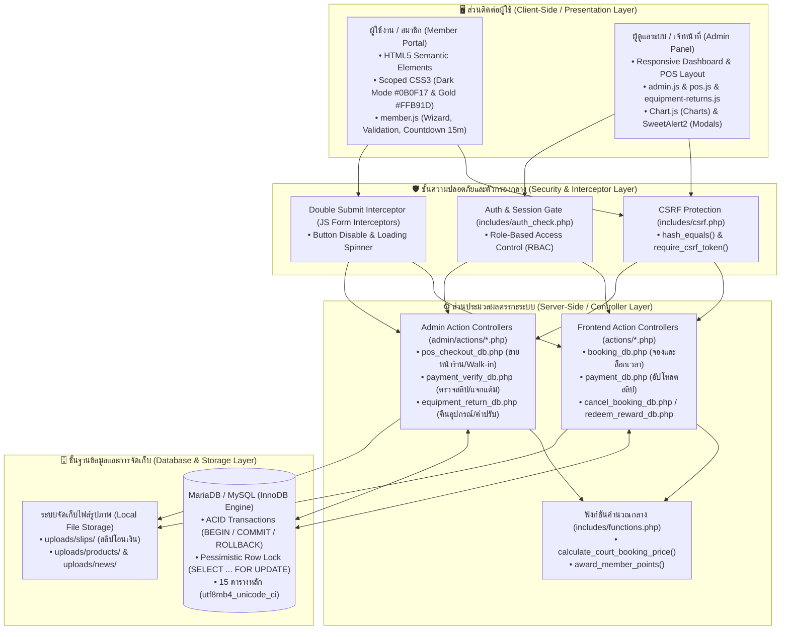
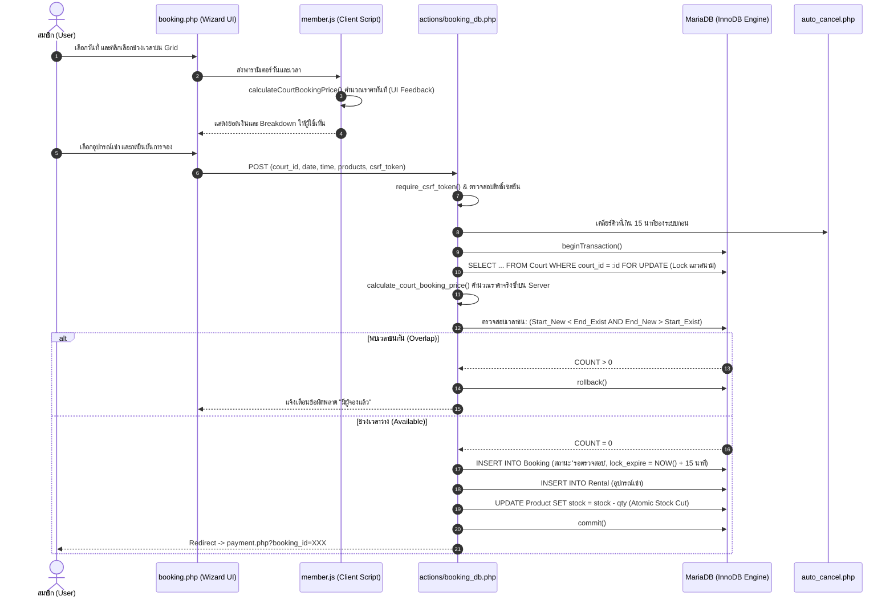
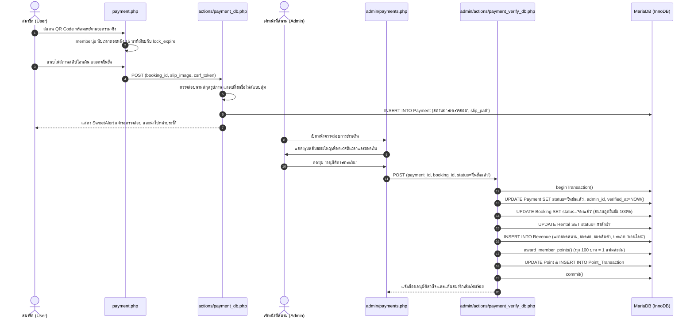
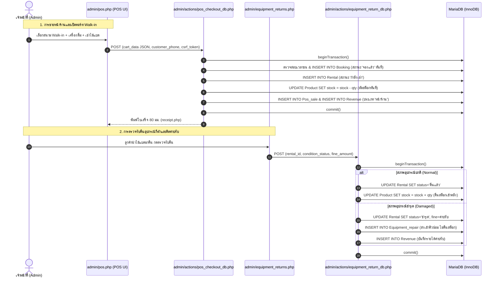
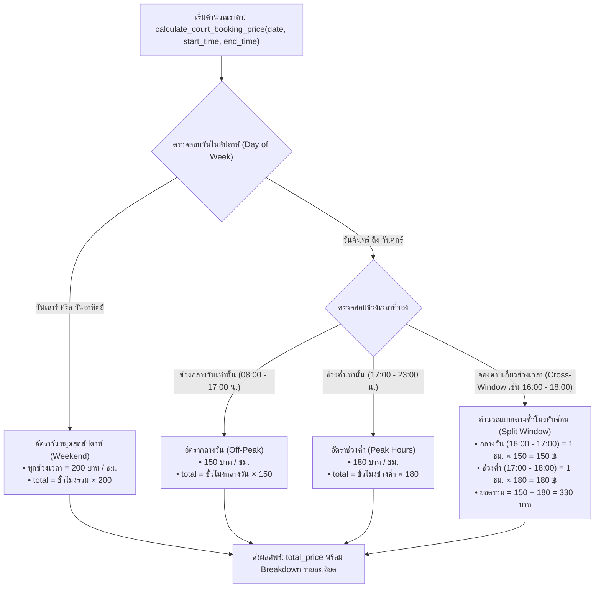

# คู่มือทำความเข้าใจระบบและเตรียมสอบโปรเจกต์ฉบับสมบูรณ์ (T.S. Pattani Defense Handbook & Visual Diagrams)

เอกสารฉบับนี้จัดทำขึ้นเพื่อเป็น **แผนผังความเข้าใจและคู่มือเตรียมสอบโครงงาน** สำหรับระบบบริหารจัดการและการจองสนามแบดมินตัน ที.เอส. ปัตตานี (T.S. Badminton Pattani) โดยถอดรหัสจากซอร์สโค้ดจริงทุกบรรทัด แสดงการเชื่อมโยงระดับไฟล์ การไหลของข้อมูล (Sequence Diagrams) ตรรกะอัลกอริทึมหลัก และแนวทางการตอบคำถามกรรมการสอบ

---

## 1. แผนภาพสถาปัตยกรรมระบบภาพรวม (System Architecture Overview)

---

## 2. ตารางแมปปิ้งความเชื่อมโยงระดับไฟล์ (File Architecture Mapping)

### ก. ระบบฝั่งสมาชิก (Frontend / Member Portal)

| หน้าจอแสดงผล (View) | ไฟล์ JS ที่ควบคุม | ไฟล์ Action ปลายทาง (POST/AJAX) | ตาราง DB ที่ได้รับผลกระทบ | คำอธิบายหน้าที่ |
| :--- | :--- | :--- | :--- | :--- |
| `index.php` | `member.js` | *(Read-only)* | `Court`, `News` | แสดงข้อมูลสนามและข่าวสาร |
| `booking.php` | `member.js` | `actions/booking_db.php` | `Booking`, `Rental`, `Product` | ระบบจอง 5 ขั้นตอน ล็อกสนาม 15 นาที และตัดสต็อกเช่า |
| `payment.php` | `member.js` | `actions/payment_db.php` | `Payment`, `Booking` | แสดง QR Code, นับถอยหลัง 15 นาที และอัปโหลดสลิป |
| `booking_history.php` | `member.js` | `actions/cancel_booking_db.php` | `Cancellation`, `Booking` | ดูประวัติการจอง ตรวจสอบสถานะ และยื่นขอยกเลิก |
| `rewards.php` | `member.js` | `actions/redeem_reward_db.php` | `Point`, `Point_Transaction`, `Reward` | ดูแต้มสะสม ระดับสมาชิก และกดแลกของรางวัล |
| `news.php` | `member.js` | `actions/get_news_detail.php` (AJAX) | `News` | แสดงรายละเอียดข่าวสารและโปรโมชั่นในกล่อง Modal |
| `contact.php` | `member.js` | `actions/send_chat_db.php` | `Chat` | ส่งข้อความสนทนาถึงเจ้าหน้าที่สนาม |
| `profile.php` | `member.js` | `actions/profile_edit_db.php` | `Member` | แก้ไขข้อมูลส่วนตัวและเปลี่ยนรหัสผ่าน |
| `login.php` | `member.js` | `actions/login_db.php` | `Member` | ตรวจสอบรหัสผ่าน `password_verify` และสร้างเซสชัน |
| `register.php` | `member.js` | `actions/register_db.php` | `Member`, `Point` | สมัครสมาชิกใหม่และเปิดบัญชีแต้มสะสม |
| `forgot_password.php` | `member.js` | `actions/forgot_password_db.php` | `Password_Resets` | ขอยื่นรีเซ็ตรหัสผ่านและสร้าง Token Hash |

### ข. ระบบฝั่งผู้ดูแลระบบ (Backend / Admin Panel)

| หน้าจอแสดงผล (View) | ไฟล์ JS ที่ควบคุม | ไฟล์ Action ปลายทาง (POST/AJAX) | ตาราง DB ที่ได้รับผลกระทบ | คำอธิบายหน้าที่ |
| :--- | :--- | :--- | :--- | :--- |
| `admin/index.php` | `admin.js` (Chart.js) | *(Query กลาง)* | `Revenue`, `Booking`, `Member`, `Court` | แดชบอร์ดสรุปรายได้และกราฟสถิติ |
| `admin/pos.php` | `pos.js` | `admin/actions/pos_checkout_db.php` | `Booking`, `Rental`, `Product`, `Pos_sale`, `Revenue`, `Point` | ขายหน้าร้าน เปิดคอร์ท Walk-in และตัดสต็อกสินค้า |
| `admin/payments.php` | `admin.js` | `admin/actions/payment_verify_db.php` | `Payment`, `Booking`, `Rental`, `Revenue`, `Point`, `Point_Transaction` | ตรวจสลิป อนุมัติการจอง บันทึกรายได้ และแจกแต้ม |
| `admin/cancellations.php`| `admin.js` | `admin/actions/cancellation_action_db.php` | `Cancellation`, `Booking`, `Product`, `Point` | พิจารณาคำขอยกเลิก ปลดล็อกคอร์ท และคืนแต้ม |
| `admin/equipment_returns.php`| `equipment-returns.js` | `admin/actions/equipment_return_db.php` | `Rental`, `Product`, `Equipment_repair`, `Revenue` | ตรวจรับคืนอุปกรณ์ เช็คชำรุด คืนสต็อก และคิดค่าปรับ |
| `admin/courts.php` | `admin.js` | `court_add_db.php` / `court_edit_db.php` / `court_delete_db.php` | `Court` | จัดการข้อมูลคอร์ทสนามและอัตราค่าบริการ |
| `admin/court_repairs.php` | `admin.js` | `court_repair_add_db.php` / `court_repair_finish_db.php` | `Court_repair`, `Court` | บันทึกการส่งสนามซ่อมบำรุงและปิดปรับปรุง |
| `admin/products.php` | `admin.js` | `product_add_db.php` / `product_edit_db.php` / `product_delete_db.php` | `Product` | จัดการรายการสินค้า เครื่องดื่ม และอุปกรณ์กีฬา |
| `admin/purchases.php` | `admin.js` | `purchase_add_db.php` | `Purchase`, `Product` | บันทึกการซื้อสินค้าเข้าคลังและเพิ่มยอดสต็อก |
| `admin/members.php` | `admin.js` | `member_edit_db.php` | `Member`, `Point` | จัดการข้อมูลสมาชิก ปรับแต้ม และระงับสิทธิ์ |

---

## 3. แผนภาพเจาะลึกการไหลของข้อมูล 3 วงจรหลัก (Sequence Diagrams)

### 🏸 วงจรที่ 1: ขั้นตอนการจองสนามและการล็อกเวลา 15 นาที (Booking Flow)

---

### 💳 วงจรที่ 2: ขั้นตอนการชำระเงิน ตรวจสลิป และแจกแต้มสะสม (Payment & Verification Flow)

---

### 🏪 วงจรที่ 3: ระบบหลังบ้าน POS, การตรวจรับคืนอุปกรณ์ และงานซ่อมบำรุง (Backend Operations)

---

## 4. แผนผังตรรกะการคำนวณราคาแบบแบ่งช่วงเวลา (Pricing Logic Flowchart)

---

## 5. คลังคำตอบดักคำถามกรรมการ (Top 10 Technical Q&A Cheat Sheet)

| ลำดับ | หัวข้อคำถามของกรรมการ | แนวทางการตอบสั้นกระชับ 2-3 บรรทัด (สำหรับพูดสดในห้องสอบ) |
| :---: | :--- | :--- |
| **Q1** | **ทำไมไม่ใช้ Framework เช่น Laravel?** | "ระบบนี้ต้องการความเร็วสูงสุดและลด Overhead ของเซิร์ฟเวอร์ โดยใช้ PHP PDO ร่วมกับ Prepared Statements 100% ซึ่งปลอดภัยเทียบเท่า ORM แต่ยืดหยุ่นและดูแลโครงสร้างสถาปัตยกรรมแบบ Clean Architecture ได้ด้วยตัวเองทั้งหมดครับ" |
| **Q2** | **ป้องกันการจองชนกัน (Race Condition) อย่างไร?** | "ใช้ Pessimistic Locking โดยเปิด Database Transaction ร่วมกับ `SELECT ... FOR UPDATE` เพื่อล็อกแถวสนามใน InnoDB และใช้เงื่อนไขตรวจสอบช่วงเวลา `(Start_New < End_Existing AND End_New > Start_Existing)` รับประกันว่าคำขอแรกเท่านั้นที่ทำรายการสำเร็จครับ" |
| **Q3** | **ทำไมต้องเขียนฟังก์ชันคำนวณราคาซ้ำทั้งใน JS และ PHP?** | "เป็นการแบ่งหน้าที่ตามหลักความปลอดภัยครับ ฝั่ง JS ทำหน้าที่แสดงผลลัพธ์และราคาให้ผู้ใช้เห็นทันทีบนหน้าจอตามหลัก HCI ส่วนฝั่ง PHP เป็น Server Trust Boundary ที่ต้องคำนวณราคาจริงใหม่อีกครั้งเพื่อป้องกันการแอบแก้ไขยอดเงินผ่านเบราว์เซอร์ครับ" |
| **Q4** | **แก้ปัญหาผู้ใช้กดปุ่มซ้ำหลายครั้ง (Double Submit) อย่างไร?** | "ใช้ Global Form Interceptor ใน JavaScript ดักจับการ Submit เมื่อกดครั้งแรกปุ่มจะถูก Disable ทันทีและแสดง Loading Spinner และฝั่งเซิร์ฟเวอร์ยังมี Database Transaction ป้องกันการบันทึกข้อมูลซ้ำซ้อนอีกชั้นหนึ่งครับ" |
| **Q5** | **ระบบล็อก 15 นาทีทำงานอย่างไร ถ้าผู้ใช้ปิดเบราว์เซอร์หนี คอร์ทจะค้างไหม?** | "เมื่อกดยืนยัน ระบบจะตั้งสถานะ 'รอตรวจสอบ' และกำหนด `booking_lock_expire` ล่วงหน้า 15 นาที หากผู้ใช้ปิดหน้าจอหนี โมดูล `auto_cancel.php` จะตรวจสอบเวลาและปลดล็อกสนามคืนสู่สถานะว่างโดยอัตโนมัติในทุกครั้งที่มีการเรียกดูหรือจองสนามใหม่ครับ" |
| **Q6** | **ทำไมต้องเลือก InnoDB แทนที่จะเป็น MyISAM?** | "เพราะ InnoDB รองรับคุณสมบัติ ACID Transactions, รองรับ Foreign Key และที่สำคัญคือรองรับการล็อกระดับแถว (Row-Level Locking) ซึ่งจำเป็นต่อระบบจองสนามและ POS เพื่อป้องกันข้อมูลขัดแย้ง ในขณะที่ MyISAM ล็อกทั้งตารางทำให้ช้าและเสี่ยงต่อข้อมูลการเงินครับ" |
| **Q7** | **ระบบมีมาตรการความปลอดภัย (Web Security) อย่างไรบ้าง?** | "ระบบป้องกันช่องโหว่ OWASP ครบถ้วนครับ ป้องกัน SQL Injection ด้วย PDO Prepared Statements 100%, ป้องกัน XSS ด้วยการกรอง `htmlspecialchars()`, ป้องกัน CSRF ด้วย Token แบบใช้ครั้งเดียวในทุกคำขอ POST, และแฮชรหัสผ่านด้วย `password_hash()` BCRYPT ครับ" |
| **Q8** | **ระบบ POS ป้องกันสต็อกสินค้าติดลบได้อย่างไร?** | "ระบบใช้คำสั่งตัดสต็อกแบบมีเงื่อนไข (Atomic Decrement) คือ `UPDATE Product SET product_stock = product_stock - :qty WHERE product_id = :id AND product_stock >= :qty` หากสต็อกไม่พอระบบจะ Rollback ยกเลิกบิลทันที จึงไม่มีทางที่สต็อกจะติดลบครับ" |
| **Q9** | **จุดเด่นด้าน HCI (การปฏิสัมพันธ์ระหว่างมนุษย์กับคอมพิวเตอร์) คืออะไร?** | "ออกแบบตามหลัก Mobile-First โดยขยาย Touch Target ของปุ่มไม่ต่ำกว่า 48–50px ตามมาตรฐานสรีรศาสตร์, ใช้ Booking Wizard 5 ขั้นตอนเพื่อลดภาระการรับรู้ (Cognitive Load), และใช้สีสปอร์ต Dark Mode ตัดกับสีทอง `#FFB91D` ที่ได้มาตรฐานความต่างสี WCAG ครับ" |
| **Q10**| **ถ้ามีผู้ใช้เข้าใช้งานพร้อมกันจำนวนมาก มีแนวทางขยายระบบ (Scalability) อย่างไร?** | "ระบบแยกไฟล์ Static (CSS/JS/Images) ออกเป็นสัดส่วนพร้อมนำขึ้น CDN ได้ทันที, การเชื่อมต่อผ่าน PDO รองรับการแยก Read/Write Replicas และสามารถติดตั้ง Redis หรือ Memcached เพื่อแคชตารางเวลาสนาม ลดภาระ Query ของฐานข้อมูลได้ทันทีครับ" |

